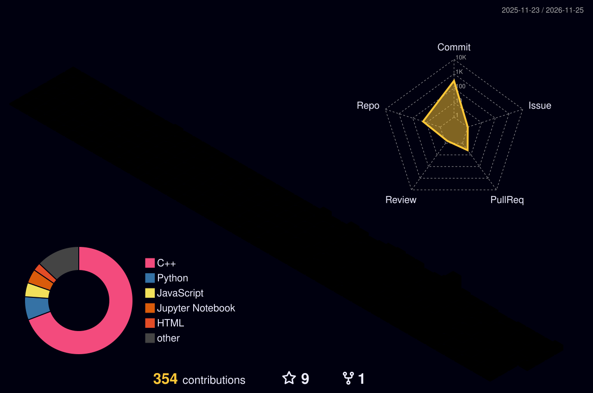

<!-- ========================================================================= -->
<!-- HEADER & TACTICAL HERO BANNER                                             -->
<!-- ========================================================================= -->
<div align="center">
  

  <a href="https://github.com/ishanegi7">
    
  </a>
</div>

<div align="center">
  
  
  
</div>

<br/>

<!-- ========================================================================= -->
<!-- 3D MONEY HEIST ANIMATED TELEMETRY & VAULT MATRIX                          -->
<!-- ========================================================================= -->
<div align="center">
  
</div>

<br/>

<!-- ========================================================================= -->
<!-- 01 // MISSION BRIEF & DOSSIER                                             -->
<!-- ========================================================================= -->
### 🔴 `[01] // MISSION BRIEF (DOSSIER)`

```yaml
OPERATIVE     : Isha Negi (@ishanegi7)
CODENAME      : The Architect
SPECIALIZATION: End-to-End Deep Learning, Self-Healing RAG, LLM Security Automation
CURRENT_PLAN  : Engineering fault-tolerant autonomous agent pipelines and self-auditing knowledge graphs
DIRECTIVE     : "Rule #1: Every system must self-heal before latency spikes. No exceptions."
```

> **The Professor's Calculus:** *“In a high-stakes heist, surprises are design failures. In machine learning systems, hallucinations and semantic drift are the equivalent of an alarm going off. I engineer architectures that detect, quarantine, and repair drift before generation occurs.”*

---

<!-- ========================================================================= -->
<!-- 02 // THE BLUEPRINT (FEATURED OPERATIONS)                                -->
<!-- ========================================================================= -->
### 🏛️ `[02] // THE BLUEPRINT (FLAGSHIP OPERATIONS)`

<table width="100%" border="0" cellspacing="0" cellpadding="0">
  <tr>
    <!-- OPERATION 01: ContextDrift -->
    <td width="50%" valign="top">
      <div align="left">
        <h4>⚡ <a href="https://github.com/ishanegi7/ContextDrift">OPERATION: ContextDrift</a></h4>
        <p><i>Self-Healing RAG Middleware</i></p>
        <p>
          
          
          
        </p>
        <p>Real-time middleware auditing streaming ingestion pipelines for semantic contradictions, dynamic hallucination penalties, and automated topological graph reconciliation.</p>
        <ul>
          <li><b>Vector Audit:</b> Cross-entropy verification against baseline graph triples.</li>
          <li><b>Fail-Safe:</b> Automatic node quarantine during semantic drift spikes.</li>
        </ul>
      </div>
    </td>
    <!-- OPERATION 02: GuardRail AI -->
    <td width="50%" valign="top">
      <div align="left">
        <h4>🛡️ <a href="https://github.com/ishanegi7/GuardRail-">OPERATION: GuardRail AI</a></h4>
        <p><i>Autonomous API Security & Patching Platform</i></p>
        <p>
          
          
          
        </p>
        <p>Adversarial LLM execution engine targeting OWASP API Top 10 vulnerabilities (BOLA/IDOR), running continuous AST penetration tests, and synthesizing verified code hotfixes.</p>
        <ul>
          <li><b>Red-Team LLM:</b> Synthesizes adversarial payloads to crack endpoint RBAC.</li>
          <li><b>Self-Healing:</b> Directly generates and runs unit tests for dynamic patches.</li>
        </ul>
      </div>
    </td>
  </tr>
  <tr>
    <!-- OPERATION 03: QueueMind -->
    <td width="50%" valign="top">
      <div align="left">
        <h4>🧠 <a href="https://github.com/ishanegi7/QueueMind">OPERATION: QueueMind</a></h4>
        <p><i>Emergency Flow & Triage Predictive Engine</i></p>
        <p>
          
          
          
        </p>
        <p>High-precision stochastic queue intelligence system forecasting emergency department admissions and dynamic bottleneck shifts under sudden surge loads.</p>
        <ul>
          <li><b>Horizon Forecast:</b> Multi-horizon patient triage arrival estimation.</li>
          <li><b>Explainable AI:</b> Real-time SHAP feature attribution for triage clinicians.</li>
        </ul>
      </div>
    </td>
    <!-- OPERATION 04: EdgeNeural -->
    <td width="50%" valign="top">
      <div align="left">
        <h4>👁️ <a href="https://github.com/ishanegi7">OPERATION: EdgeNeural</a></h4>
        <p><i>Sub-Millisecond Edge Vision Pipeline</i></p>
        <p>
          
          
          
        </p>
        <p>Hardware-quantized edge perception pipeline achieving sustained 120 FPS object tracking and anomaly localization on resource-constrained embedded runtimes.</p>
        <ul>
          <li><b>Optimization:</b> FP16/INT8 dynamic quantization via ONNX Runtime.</li>
          <li><b>Telemetry:</b> Zero-drop IPC streaming protocol for low-bandwidth relays.</li>
        </ul>
      </div>
    </td>
  </tr>
</table>

---

<!-- ========================================================================= -->
<!-- 03 // THE ARSENAL (TECH STACK) - SLEEK COMPACT BADGES                     -->
<!-- ========================================================================= -->
### 🧰 `[03] // THE ARSENAL (TACTICAL WEAPONRY)`

<table width="100%" border="0" cellspacing="0" cellpadding="0">
  <tr>
    <td width="28%"><b>Core AI / ML & DL</b></td>
    <td>
      
      
      
      
      
      
      
      
    </td>
  </tr>
  <tr>
    <td><b>LLMs, RAG & Data</b></td>
    <td>
      
      
      
      
      
      
      
      
      
    </td>
  </tr>
  <tr>
    <td><b>Systems & Languages</b></td>
    <td>
      
      
      
      
      
      
    </td>
  </tr>
</table>

---

<!-- ========================================================================= -->
<!-- 04 // TELEMETRY & 3D ACTIVITY MATRIX                                      -->
<!-- ========================================================================= -->
### 📊 `[04] // TELEMETRY & 3D ACTIVITY MATRIX`

<div align="center">
  <a href="https://github.com/ishanegi7">
    
  </a>
  <a href="https://github.com/ishanegi7">
    
  </a>
</div>

<br/>

<div align="center">
  <!-- 3D Isometric Contribution Graph Matrix Generated via GitHub Action -->
  <picture>
    <source media="(prefers-color-scheme: dark)" srcset="profile-3d-contrib/profile-night-rainbow.svg">
    <source media="(prefers-color-scheme: light)" srcset="profile-3d-contrib/profile-night-rainbow.svg">
    
  </picture>
</div>

---

<!-- ========================================================================= -->
<!-- 05 // SECURE COMMS & FREQUENCIES                                          -->
<!-- ========================================================================= -->
### 📡 `[05] // SECURE COMMS & FREQUENCIES`

<p align="center">
  <a href="https://linkedin.com/in/ishanegi7">
    
  </a>
  &nbsp;
  <a href="https://github.com/ishanegi7">
    
  </a>
  &nbsp;
  <a href="mailto:ishanegi.ai@gmail.com">
    
  </a>
  &nbsp;
  <a href="https://github.com/ishanegi7?tab=repositories">
    
  </a>
</p>

<div align="center">
  
</div>
